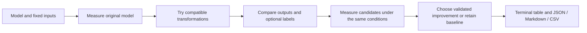

# Kernelixx

[](https://github.com/lsimg/Kernelixx/actions/workflows/tests.yml)

[Русская инструкция](README.ru.md) · [Architecture](docs/ARCHITECTURE.md) ·
[Development stages and engineering decisions](docs/DEVELOPMENT_HISTORY.md) ·
[Changelog](CHANGELOG.md) · [Measured evidence](docs/VALIDATION.md)

A Python CLI for profiling, transforming, validating, and benchmarking existing
PyTorch models. Kernelixx measures each candidate against the unmodified model
and retains the baseline when no validated candidate improves the chosen metric.
There is no web server, GUI, or hosted service.

The public package, import name and terminal command are all **kernelixx**.
This repository is the first public import of the locally developed project;
its earlier experiments and subsequent improvements are documented rather than
presented as a fabricated Git commit history.

## What happens during an experiment



An optimization is successful only when it passes the configured correctness
policy and improves the selected objective by the required margin. Converting a
model successfully, agreeing on a few classes, or reducing weight storage alone
does not satisfy every objective. Full data flow, module contracts, formulas and
failure handling are described in [ARCHITECTURE.md](docs/ARCHITECTURE.md).

## Development stages

| Stage | Delivered work | Verification / follow-up |
|---|---|---|
| 1. Infrastructure | Python package, argparse CLI, model factories, CPU/CUDA selection | Module and installed console entry points |
| 2. Analysis | Parameters, storage accounting, actual timings, Profiler rankings | CPU execution and device fallback |
| 3. Optimization | CUDA FP16, CPU ONNX, CPU Linear INT8, guarded Inductor | Real backend execution; failures and skips retained |
| 4. Automatic selection | Latency, throughput, GPU memory and balanced criteria | Baseline retained when no eligible improvement exists |
| 5. Validation | Numerical deviations, class agreement, labeled accuracy | Unchanged tolerance policy; no synthetic accuracy claims |
| 6. Reports | JSON, Markdown, CSV and saved-report reader | Raw timings, versions, seeds and configuration retained |
| 7. Training experiment | Small-CNN FP32 versus CUDA AMP | Real training iterations; slower AMP outcome preserved |
| 8. Tests and packaging | Automated suite, wheel/sdist/ZIP, isolated installation | Windows CPU/CUDA locally; CI matrix authored |
| 9. Real data | Pretrained ResNet18/50 on 200 selected validation images | Original ImageNet filename filtering and label mapping |
| 10. Batching and repeats | Batch 1 versus 8, then three paired trials | Separate throughput ratios and cross-batch output check |
| 11. Inspectable predictions | Every photo paired with its answer | 30 ResNet50 fixes, six regressions, complete result tables |
| 12. User images | Explicit image paths, top-5 predictions, static reports | Seven apple screenshots; class-vocabulary limits documented |
| 13. Public release | Kernelixx rename, consistent imports/CLI, publication docs | Revalidated tests and rebuilt distributions |

See [DEVELOPMENT_HISTORY.md](docs/DEVELOPMENT_HISTORY.md) for the reasons behind
each change, what failed, and which observations support the results. Gemma and
Ollama were discussed as future extensions; **neither backend is implemented**.

## Problem statement

Inference cost depends on architecture, batch size, numerical precision, hardware,
and backend. Applying a transformation alone does not establish a speedup or
preserved accuracy. Small teams need an inspectable experiment that distinguishes
weight storage, peak GPU allocations, numerical deviation, and real task accuracy.

## Proposed solution

Kernelixx runs a seeded baseline, applies compatible transformations independently,
compares outputs on identical inputs, measures steady-state execution, and writes
JSON, Markdown, and CSV evidence. Failed, unsupported, numerically rejected, and
slower candidates remain visible in the report.

## Key features

- ResNet18, ResNet50, and trusted custom Python model factories.
- Parameter counts, trainable counts, weight bytes, serialized bytes, device and precision.
- PyTorch Profiler operator rankings for potential bottlenecks.
- CUDA FP16, ONNX Runtime graph optimization on CPU, dynamic INT8 Linear layers,
  and `torch.compile`/Inductor where the platform supports it.
- Automatic selection by latency, throughput, GPU memory, or a documented balanced score.
- Elementwise numerical validation, class agreement, and optional labeled-dataset accuracy.
- Real warmup/repeated timings, median, p95, synchronized CUDA, and raw latency samples.
- A separate, limited small-CNN FP32 versus AMP training experiment.

## Technical architecture

```text
kernelixx/
  cli.py                    argparse commands, terminal output, exit codes
  core/
    analyzer.py             PyTorch Profiler diagnostics
    benchmark.py            timing, storage accounting, comparisons, runner contract
    optimizer.py            baseline, candidate lifecycle, AutoOptimizer, selection
    validator.py            numerical and classification checks
  models/loader.py          torchvision models and module:factory loading
  optimizations/
    precision.py            CUDA FP16 inference
    quantization.py         CPU dynamic INT8 Linear layers
    graph.py                ONNX export and ORT_ENABLE_ALL execution
    fusion.py               Inductor compilation, without unverified fusion claims
  reporting/reporter.py      JSON, Markdown, CSV, latest report copies
  training/benchmark.py      isolated small CNN training comparison
  utils/device.py           CPU fallback, seeds, versions, synchronization
tests/                      unit and real backend integration tests
examples/                   custom model and synthetic NPZ examples
results/                    generated local experiment artifacts (gitignored)
```

Each candidate starts from a copy of the same original CPU model. Only one target
model is resident on the GPU at a time. Baseline validation outputs are stored on
CPU before the baseline runner is released. Transformations are not composed.

## Installation

Python **3.11** is the target; Python 3.12 is also supported. Use a local environment.
This release supports the PyTorch 2.9 / torchvision 0.24 pair, tested at 2.9.1 / 0.24.1.
It bounds PyTorch below 2.10
because it uses the deprecated `torch.ao.quantization` dynamic API.

Windows PowerShell, CPU-only:

The first two commands clone the repository and enter its directory; run the
remaining installation commands from that directory containing `pyproject.toml`.
Make sure `python` refers to Python 3.11 or 3.12; use `py -3.11` or `py -3.12`
instead for the first command if needed. Activation is not required.

```powershell
git clone https://github.com/lsimg/Kernelixx.git
cd Kernelixx
python -m venv .venv
.\.venv\Scripts\python.exe -m pip install --upgrade pip
.\.venv\Scripts\python.exe -m pip install torch==2.9.1+cpu torchvision==0.24.1+cpu --index-url https://download.pytorch.org/whl/cpu
.\.venv\Scripts\python.exe -m pip install -e ".[onnx,dev]"
.\.venv\Scripts\python.exe -m kernelixx system-info
```

For a compatible NVIDIA driver, install the CUDA build **instead of** the CPU build:

```powershell
.\.venv\Scripts\python.exe -m pip install torch==2.9.1+cu128 torchvision==0.24.1+cu128 --index-url https://download.pytorch.org/whl/cu128
.\.venv\Scripts\python.exe -m kernelixx system-info
```

The GPU appearing in `nvidia-smi` is insufficient: `cuda_available` in system-info
must be true. The PyTorch wheel supplies its CUDA runtime; Inductor additionally
needs a working compiler stack. Consult the [PyTorch installation matrix](https://pytorch.org/get-started/previous-versions/)
for other driver/version combinations.

Linux/macOS CPU: create a venv with `python3.11 -m venv .venv`, activate it,
install an appropriate PyTorch pair, and run `python -m pip install -e '.[onnx,dev]'`.
MPS is outside v1 scope. ONNX dependencies are optional; without them ONNX is skipped.
No network or pretrained-weight download is needed for the default experiments.

The wheel installs the `kernelixx` package and terminal entry point. The source
ZIP, source distribution and repository also contain `examples/`, `tests/`,
`tools/` and the experiment documentation. Run repository examples from the
directory containing `pyproject.toml`.

An environment path such as `.venv/Scripts/python.exe` and report paths such as
`results/latest` are relative to the current terminal directory. When working
elsewhere, use the full interpreter and report paths for this project.

## CLI usage

Commands below assume the environment's Python is active. On Windows you can
replace `python` with `.\.venv\Scripts\python.exe` without changing execution policy.

```bash
python -m kernelixx --help
python -m kernelixx system-info
python -m kernelixx analyze --model resnet18 --device cuda
python -m kernelixx benchmark --model resnet50 --device cpu
python -m kernelixx optimize --model resnet18 --method fp16 --device cuda
python -m kernelixx optimize --model resnet18 --method onnx --device cpu
python -m kernelixx optimize --model resnet18 --method quantization --device cpu
python -m kernelixx optimize --model resnet18 --method compile --device cuda
python -m kernelixx auto-optimize --model resnet18 --device cuda --objective latency
python -m kernelixx auto-optimize --model resnet18 --device cpu --methods onnx quantization
python -m kernelixx compare --run-dir results/latest
python -m kernelixx train-benchmark --device cuda --steps 20 --batch-size 16
```

All inference commands share `--input-shape`, `--seed`, `--threads`, `--warmup`,
`--repeats`, `--validation-batches`, `--weights`, `--dataset`, `--atol`, `--rtol`,
`--max-accuracy-drop`, `--task`, `--min-improvement`, `--objective`, `--output`, and `--json`.
Run a subcommand with `--help` for defaults. `--json` emits a complete structured
report on stdout; library diagnostics may still appear on stderr.

Default weights are randomly initialized and explicitly labeled `none`.
`--weights default` downloads torchvision's pretrained weights and records that
choice. Random-weight experiments test plumbing/performance, not model utility.
The user must supply correctly normalized data for the chosen weights.

Each experiment creates `results/<UTC timestamp>-<unique id>/report.json`,
`report.md`, and `metrics.csv`. `results/latest/` contains copies of those three
files and points to the original run directory inside JSON. ONNX candidates also
save `onnx/model.onnx` in the original run directory. `compare` reads existing
measurements, without re-executing models. PyTorch candidates are evaluated in
memory; no portable compiled executable or optimized PyTorch checkpoint is promised.

Exit codes: `0` completed experiment, `2` invalid input/runtime failure or a
single requested optimization that was skipped/rejected/failed, `130` interruption.
Auto optimization exits `0` when it completes and retains the baseline; consult
candidate statuses and `selection.improved` in JSON. A slower but numerically
valid single candidate exits `0` and is explicitly not selected as an improvement.

## Optimization methods

| Method | Backend/device | Scope and compatibility |
|---|---|---|
| `fp16` | PyTorch / CUDA | Converts floating weights, buffers, and inputs to FP16. Requires GPU capability >= 5.3; unsupported operators fail the candidate. This is explicit half precision inference, not training AMP. |
| `onnx` | ONNX Runtime / CPU | Exports opset 17 with a dynamic batch axis, validates the graph, enables ORT_ENABLE_ALL. Export/session creation are excluded from timing. Unsupported export operators are reported as failures. |
| `compile` | PyTorch Inductor | Compiles supported graphs; first execution happens before timed repetitions. CUDA requires compatible Triton. Windows CPU requires MSVC `cl.exe`; actual backend failures are reported. Compilation is not proof of kernel fusion. |
| `quantization` | PyTorch / CPU | Dynamic qint8 `nn.Linear` only, using an available x86/fbgemm/onednn/qnnpack engine. ResNet's convolution layers remain FP32; reduction may be small. No calibration dataset required. |

Windows support is checked conservatively. Missing compiler/Triton is a documented
skip, not a claim that compilation succeeded. ONNX CUDA and GPU INT8 are outside
v1 scope; the tool never substitutes a CPU result into a GPU speedup.
Every compilation candidate records `fusion_confirmed: false` because this version
does not parse compiler fusion evidence. No custom CUDA compiler is implemented.

## Benchmarking methodology

1. Seed Python, NumPy and PyTorch; disable TF32 and cuDNN autotuning, request
   deterministic algorithms with warnings for unsupported cases; fix CPU threads.
2. Load/eval the original FP32 model and create fixed inputs outside timing.
3. Warm up (default 5 iterations), synchronize CUDA, reset CUDA peak statistics.
4. Measure 30 individual iterations with `perf_counter_ns`; synchronize before
   and after each CUDA forward. Retain raw samples, median and NumPy p95.
5. Throughput is `batch_size * repetitions / sum(iteration_seconds)` for this
   sequential, synchronized workload. It is not concurrent server throughput.
6. Compare candidates under the same device, input shape, batch, thread settings,
   warmup and repetition count. FP16's input dtype is intentionally different.
7. Report `speedup = baseline_median / candidate_median`; values below 1 are slower.
   Report memory reduction as `100 * (1 - candidate_peak / baseline_peak)`;
   negative values indicate increased memory.

`weight_bytes` counts tensors in state dictionaries, including buffers and packed
quantized weights/biases; it excludes Python metadata, quantization scale metadata,
and allocator overhead. ONNX uses initializer array bytes. Serialization size is
reported separately and backend serialization formats differ. Neither is called
peak inference memory.

`peak_gpu_memory_bytes` is peak **PyTorch allocated** memory with the target
model and inputs resident, including the inference output. It excludes CUDA context,
non-PyTorch allocations, reserved allocator cache and other processes. Resident
memory before execution and transient allocation delta are reported separately.
CPU peak memory is `null`: process RSS and Python tracemalloc would not give a
comparable isolated tensor-allocation metric. Memory objectives do not silently
substitute weight size when peak memory is unavailable.

Profiler results come from a separate untimed inference; self CPU/device time
rankings indicate potential bottlenecks and do not prove an optimization will help.
Conversion, input transfers and compilation are excluded from steady-state latency;
candidate `setup_seconds` records transformation and initial execution separately.
ORT dispatch and its zero-copy CPU input / Tensor output wrapping are included.

### Automatic selection

Numerically invalid candidates and different-device measurements cannot win.
Baseline normalized score is 1; a candidate must improve by more than
`--min-improvement` (default 0.01):

- `latency`: candidate median / baseline median.
- `throughput`: baseline throughput / candidate throughput.
- `memory`: candidate GPU peak / baseline GPU peak.
- `balanced`: square root of (latency ratio * GPU memory ratio), with equal log weights.

Lower is better. Memory and balanced require measured GPU peak allocation; on CPU,
selection explicitly reports that the objective cannot be evaluated. These are
single-session decisions, not statistical significance claims. Repeat independent
runs and inspect distributions, especially for small apparent improvements.

## Validation and labeled data

Validation uses three independent seeded synthetic batches by default, all shared
between baseline and candidates. A candidate passes only if outputs have matching
shapes, all values are finite, and **every element** satisfies:

```text
abs(candidate - reference) <= atol + rtol * abs(reference)
```

Reports contain max/mean absolute error and max relative error (denominator
`max(abs(reference), 1e-8)`). Relative errors around zero can be large even when
the tolerance rule passes. For classification `[N, classes]` logits, reports also
show argmax class agreement. `--task auto` infers classification only for built-in
ResNets or supplied labeled data. Use `--task classification` for custom classifiers;
custom models otherwise receive numerical validation without class claims.
`--task regression` explicitly disables class comparisons.
**Numerical agreement is not real task accuracy.** Thresholds should come from a
model's requirements, not be relaxed just to advertise a successful transformation.

For accuracy, supply an NPZ with `inputs` (finite preprocessed `float32 [N,...]`)
and `labels` (`int64 [N]`, zero-based class IDs). All supplied samples, including the
last partial batch, are validated. Performance is measured on the first batch.
Accuracy drop must additionally be <= `--max-accuracy-drop` (default 0.01 absolute,
i.e. one percentage point). This contract supports classification, not arbitrary tasks.

```bash
python -m examples.make_dataset --output results/synthetic-labels.npz
python -m kernelixx optimize --model examples.custom_model:load_model --device cpu --method onnx --input-shape 8,16 --dataset results/synthetic-labels.npz
```

The example labels are explicitly **synthetic** and demonstrate the data contract;
they do not establish real task accuracy. Use an independently representative
labeled dataset and appropriate preprocessing to assess a production model.

### Real-image example: pretrained ResNet18 and Imagenette

Prepare a reproducible, balanced subset of 200 real images (20 per
category) using the official [Imagenette](https://github.com/fastai/imagenette)
160px archive (about 100 MB). Run preparation once; an existing output is preserved
and can be reused for later experiments:

```powershell
.\.venv\Scripts\python.exe -m examples.prepare_imagenette --download --samples 200
.\.venv\Scripts\python.exe -m kernelixx auto-optimize --model resnet18 --weights default --device cuda --methods fp16 --dataset results/datasets/imagenet-val-resnet18-200.npz --warmup 10 --repeats 50 --output results/imagenette-gpu
.\.venv\Scripts\python.exe -m kernelixx auto-optimize --model resnet18 --weights default --device cpu --methods onnx quantization --dataset results/datasets/imagenet-val-resnet18-200.npz --warmup 5 --repeats 30 --output results/imagenette-cpu
```

The preparer uses the pretrained weights' official resize/crop/normalization,
maps Imagenette WNID folders to the original ImageNet-1K class indices, and retains
all 1000 model outputs for argmax. Local Imagenette labels 0..9 must not be compared
directly with this model's 1000-way predictions. Sampling is seeded, without
replacement, and independent of model predictions.

Imagenette's own train/val split mixes original ImageNet training and validation
files. To avoid that source of overlap with pretrained weights, the default
`--split imagenet-val` filters **both** folders to `ILSVRC2012_val_*.JPEG` and samples
from the 500 original validation images available across these ten categories.
`--split imagenette-val` is an explicit alternative and records its potential
pretraining overlap; it should not be described as held-out ImageNet evaluation.

The `.npz.json` sidecar records class mapping, preprocessing, selected filenames,
per-image SHA-256 and NPZ SHA-256. Reports show baseline/candidate accuracy on all
200 supplied images; timing uses the first single-image batch. No training occurs.
This is accuracy on a small ten-class subset, not the full ImageNet benchmark or
evidence for an unrelated production task. Default numerical tolerances and the
accuracy-drop limit remain in force even if class predictions mostly agree.
Dataset files and downloaded archives stay under gitignored `results/`.

Repeat with pretrained ResNet50 using its own preprocessing and the same seeded
image selection. The local experiment stores its downloaded weights in a project
cache under `results/torch-cache`:

```powershell
.\.venv\Scripts\python.exe -m examples.prepare_imagenette --model resnet50 --samples 200 --output results/datasets/imagenet-val-resnet50-200.npz
$env:TORCH_HOME = Join-Path (Get-Location) 'results/torch-cache'
.\.venv\Scripts\python.exe -m kernelixx auto-optimize --model resnet50 --weights default --device cuda --methods fp16 --dataset results/datasets/imagenet-val-resnet50-200.npz --warmup 10 --repeats 50 --output results/resnet50-gpu
.\.venv\Scripts\python.exe -m kernelixx auto-optimize --model resnet50 --weights default --device cpu --methods onnx quantization --dataset results/datasets/imagenet-val-resnet50-200.npz --warmup 5 --repeats 30 --output results/resnet50-cpu
```

ResNet18 DEFAULT uses IMAGENET1K_V1 weights and ResNet50 DEFAULT uses IMAGENET1K_V2.
Their official resize settings also differ. Comparing their measured accuracy is
a practical comparison of these pretrained configurations, not an experiment
isolating architecture depth. See the [ResNet50 follow-up](docs/RESNET50_VALIDATION.md).

### Review individual photos and mistakes

After preparing the real-image dataset, run from the repository/source directory:

```powershell
.\.venv\Scripts\python.exe -m examples.inspect_predictions --dataset results/datasets/imagenet-val-resnet18-200.npz
```

This reruns pretrained FP32 inference on CPU with batch size 1, preserving the
prepared dataset order and all 1000 output classes. It checks the NPZ hash, original
photo hashes, ordered labels, and preprocessing metadata before matching answers
to photos. It writes a new directory under `results/predictions/` containing:

- `predictions.csv` and `predictions.json`: every image path, expected class and prediction.
- `errors.csv`: only predictions that differ from the supplied label.
- `report.md`: links to every photo and static contact sheets of all mistakes.
- `errors-01.png`, etc.: original photos alongside the exact prepared model crops.
- `correct-examples.png`: up to six correctly classified examples.

Use `--onnx PATH_TO_SAVED_MODEL.onnx` to also check an existing export on the same
photos. Its class predictions and numerical validation are recorded separately.
Use `--output NEW_DIRECTORY` to choose a destination; existing directories are
preserved. This example supports datasets produced by `examples.prepare_imagenette`
for ResNet18/50. It does not train a model or measure new performance results.
The PNGs are static experiment artifacts; the program remains CLI-only.
See the [executed photo review](docs/PREDICTION_REVIEW.md).

Compare ResNet18 and ResNet50 on the same original photos using each model's
prepared dataset and official pretrained preprocessing:

```powershell
.\.venv\Scripts\python.exe -m examples.inspect_predictions --dataset results/datasets/imagenet-val-resnet18-200.npz --output results/review-resnet18
$env:TORCH_HOME = Join-Path (Get-Location) 'results/torch-cache'
.\.venv\Scripts\python.exe -m examples.inspect_predictions --dataset results/datasets/imagenet-val-resnet50-200.npz --output results/review-resnet50
.\.venv\Scripts\python.exe -m examples.compare_predictions --resnet18-review results/review-resnet18/predictions.json --resnet50-review results/review-resnet50/predictions.json
```

The comparison matches original manifest paths and SHA-256 hashes, regardless of
row order, and checks labels and saved answers. It reports corrected mistakes,
new mistakes, both-correct and both-wrong cases separately. CSV/JSON cover every
image; static PNG sheets show all corrected, regressed and still-wrong examples.
The comparison command reads saved predictions without rerunning inference.
Weights and preprocessing differ between the pretrained configurations, so this
does not isolate architecture depth. See the [executed comparison](docs/MODEL_COMPARISON.md).

### Predict your own image files

Supply explicit files in the order you want them displayed (quote paths with spaces):

```powershell
.\.venv\Scripts\python.exe -m examples.predict_images --images "C:\Pictures\apple.png" "C:\Pictures\another photo.jpg"
```

This runs both pretrained models on CPU with their official preprocessing. It
creates a new directory under `results/user-images/` containing JSON and CSV
top-5 answers, a Markdown report and static contact sheets. Originals are read
without modification; input SHA-256 values are recorded. `--output NEW_DIRECTORY`
chooses a destination. An existing directory is preserved. The optional
`--cache-dir` points to a torch hub cache containing `checkpoints/`; cached files
under `results/torch-cache/hub` are reused by default when present.

Answers are selected from the fixed ImageNet-1K category list. For example, its
apple category is `Granny Smith`, rather than a general-purpose fruit vocabulary.
An answer in that class does not verify an apple's variety. No exact labels are
supplied by this command, so it records **accuracy_measured: false**. Softmax
scores in JSON are model scores, not measured accuracy or calibrated confidence.
See the [executed seven-image check](docs/USER_IMAGES.md).

### Custom model contract

```python
# my_model.py (importable on PYTHONPATH)
from torch import nn

def load_model() -> nn.Module:
    return nn.Sequential(nn.Linear(16, 64), nn.ReLU(), nn.Linear(64, 4))
```

```bash
python -m kernelixx analyze --model my_model:load_model --input-shape 8,16 --device cpu
```

The factory is trusted Python code, called without arguments. It returns a CPU
`nn.Module` and owns custom weight loading. Kernelixx normalizes it to FP32/eval.
v1 requires one floating input Tensor and one nonempty floating output Tensor,
a batch dimension, and side-effect-free inference on reusable inputs. Models
with dict/tuple inputs/outputs, mutable inference state, or custom weight tying
requiring unusual serialization need an adapter and are outside this contract.

## Reproducible experiments

See [local validation evidence](docs/VALIDATION.md) and the
[GPU follow-up](docs/GPU_VALIDATION.md), plus the
[pretrained real-image experiment](docs/REAL_IMAGE_VALIDATION.md), for executed checks, measured results and
remaining compiler limitations. CUDA FP16 inference and AMP training have been
executed on an RTX 4060 Laptop GPU; the full suite has **74 passing tests**,
including photo-to-prediction mapping, cross-model comparisons, user image files and report generation.
Rejection of an FP16 candidate remains a valid result when it exceeds the
requested numerical tolerances; GPU support alone does not guarantee acceptance.
The [tested CPU dependency snapshot](requirements-tested-cpu.txt)
pins direct libraries used locally; it is not a complete transitive lockfile.
To recreate it in a clean environment, install with
`python -m pip install -r requirements-tested-cpu.txt --extra-index-url https://download.pytorch.org/whl/cpu`,
then `python -m pip install -e .`.
For the tested CUDA environment, use [requirements-tested-cuda.txt](requirements-tested-cuda.txt)
with `--extra-index-url https://download.pytorch.org/whl/cu128` instead.

```bash
python -m kernelixx benchmark --model resnet18 --device cpu --seed 42 --threads 1 --warmup 5 --repeats 30
python -m kernelixx auto-optimize --model resnet18 --device cpu --methods onnx quantization --seed 42 --threads 1 --warmup 5 --repeats 30
python -m kernelixx optimize --model resnet18 --method fp16 --device cuda --seed 42 --warmup 10 --repeats 50
python -m kernelixx train-benchmark --device cuda --seed 42 --steps 20 --warmup 3 --batch-size 16
python -m pytest -q
```

Reports record versions, hardware, seed, shape, device, numerical thresholds,
raw timings and candidate errors. Keep the report together with any custom model
source, dependency snapshot and dataset identity. The JSON report records the
dataset path and SHA-256; dataset contents and custom source are not embedded. Hardware power
state, background processes and thermal throttling still affect repeatability.

In restricted Windows environments where the system temporary directory is
unwritable, use a **new** workspace test directory:
`python -m pytest -q --basetemp results/pytest-local`.
Pytest owns and may clear its basetemp; never point it at user data.

The training experiment uses identical initial CNN state, seeded synthetic
32x32 batches and SGD settings. Warmup weights/optimizer/scaler are reset before
measurement. Time includes forward/backward/update/scaler, excludes data transfer.
Loss and GradScaler trajectories are recorded. AMP may skip updates on overflow;
these results do not establish equivalent convergence or real task accuracy.

## Measured examples

Recorded local CPU sessions on 200 original ImageNet validation images from ten classes,
batch 1, one CPU thread, 5 warmup and 30 measured repetitions. ONNX passed numerical validation
and preserved all 200 class predictions for both models. Accuracy is limited to this subset.

| Model / pretrained weights | Correct / 200 | CPU baseline ms | CPU ONNX ms | CPU ONNX speedup |
|---|---:|---:|---:|---:|
| ResNet18 / IMAGENET1K_V1 | 131 | 102.944 | 52.561 | 1.959x |
| ResNet50 / IMAGENET1K_V2 | 155 | 216.445 | 131.811 | 1.642x |

These are practical pretrained configurations with different weights/resize settings and individual-session timings.
They do not isolate architecture effects or establish statistically significant gains.
See [ResNet18 evidence](docs/REAL_IMAGE_VALIDATION.md) and [ResNet50 evidence](docs/RESNET50_VALIDATION.md)
for complete reports, GPU results, failed candidates, dataset manifests and reproduction commands.

The [batching experiment](docs/BATCHING_VALIDATION.md) measured FP32 ResNet50 on CUDA
at 73.3 images/s with batch 1 and 327.3 images/s with batch 8, with the same 155/200
correct predictions and a passing cross-batch numerical check. Peak allocated GPU
memory rose from 158.6 to 214.9 MiB. This is a 4.46x **throughput** ratio for different
workloads; batch latency increased from 13.0 to 23.9 ms. It is not a single-image
latency speedup. FP16 batch 8 was faster than FP32 batch 8 but failed validation.

Existing CLI commands accept `--input-shape 8,3,224,224`. Reports explicitly label
latency as per-batch and Samples/s as individual examples. The standalone
`python -m examples.validate_batching --help` diagnostic checks FP32 output equivalence
on the same ordered labeled tensors when their grouping changes.

A [three-pair repeat study](docs/REPEATABILITY_VALIDATION.md) used a fresh process
for each configuration and alternated execution order. Batch 8 had higher throughput
in all three pairs; paired ratios ranged from 3.78x to 4.88x, with median 4.65x.
All six runs retained 155/200 correct predictions. These are descriptive observations,
not a significance claim or an individual-image latency speedup.

```powershell
$env:TORCH_HOME = Join-Path (Get-Location) 'results/torch-cache'
.\.venv\Scripts\python.exe -m examples.repeat_batching --model resnet50 --trials 3
.\.venv\Scripts\python.exe -m examples.repeat_batching --read-summary results/batching-resnet50/repeats-20261101/summary.json
```

The first command runs a new study; the second reads the archived local study
without rerunning it. New studies create timestamped directories. Each records
six native reports, raw latency samples, child logs, JSON/Markdown/CSV summaries
and a separate cross-batch numerical check.

## Limitations

- Optimizations are backend-, model-, shape- and workload-dependent. Slower outcomes
  and numerical rejection are expected legitimate results.
- Built-in models default to random weights; no accuracy claim without suitable
  pretrained/custom weights and representative labeled data.
- FP16 CUDA kernels and AMP require compatible installed PyTorch and hardware.
  CUDA unavailable requests fall back to CPU with an explicit warning.
- Dynamic quantization is limited to CPU Linear layers and uses a deprecated
  PyTorch API. Migration to torchao is future work, not an unimplemented promise.
- ONNX is CPU-only, opset 17, single Tensor input/output; some operators cannot export.
- Inductor can fail after initial platform checks; errors are captured. No kernel
  fusion is asserted without evidence, and no compiler logs are synthesized.
- No CPU peak-memory measurement, energy/cost meter, training optimizer for arbitrary
  networks or universal model support. The included downloader is specifically for
  the documented Imagenette experiment, rather than an arbitrary dataset service.
- Text generation, Gemma and Ollama backends are future work. The current custom
  model contract requires one floating input/output Tensor; it is not an LLM adapter.
- Reports describe the tested workload. They do not establish superiority over
  existing optimization tools, production accuracy, or statistically significant gains.

## Build and package

From the project root, with development dependencies installed:

```powershell
.\.venv\Scripts\python.exe -m pip install -e ".[onnx,dev]"
.\.venv\Scripts\python.exe -m build
.\.venv\Scripts\python.exe tools/package_source.py
```

The build creates `dist/kernelixx-0.1.0-py3-none-any.whl` and
`dist/kernelixx-0.1.0.tar.gz`. The packaging tool adds
`dist/Kernelixx-0.1.0-source.zip`, audits all three inventories, and writes
`dist/release-manifest.json` and `dist/SHA256SUMS.txt`. Use `--overwrite` only to
replace an existing source ZIP for a new build of the same version.

Source archives include code, examples, tests, CI, documentation and archived
metric reports. They exclude `.venv/`, raw `results/`, downloaded weights, image
arrays and ONNX binaries. Dependencies and datasets are installed/downloaded
separately using the instructions above.

To install a wheel after choosing the CPU or CUDA PyTorch pair:

```powershell
.\.venv\Scripts\python.exe -m pip install "dist/kernelixx-0.1.0-py3-none-any.whl[onnx]"
```

The [historical release validation](docs/RELEASE_VALIDATION.md) records an isolated Python 3.12
CPU installation, nine installed-wheel checks from outside the checkout, and
59 passing source-distribution tests with three CUDA-only skips. The existing
CUDA development suite now has 74 passing tests. The renamed release is checked
again as described in [PUBLICATION.md](docs/PUBLICATION.md). The CI matrix builds
and checks the installed wheel on Windows/Linux with Python 3.11/3.12. Remote
workflow status can be inspected in the repository's Actions tab; local results
are not evidence of a successful remote workflow.

## Future improvements

Independent interleaved benchmark trials and confidence intervals; torchao/ONNX
static INT8 with representative calibration; ORT CUDA with I/O binding and a
backend-independent GPU memory instrument; compiler-evidence extraction for
fusion; richer task-specific validation adapters and portable model artifacts.

## Technical references

- [PyTorch CUDA memory semantics](https://docs.pytorch.org/docs/stable/notes/cuda.html#cuda-memory-management)
- [PyTorch compile API](https://docs.pytorch.org/docs/stable/generated/torch.compile.html)
- [ONNX Runtime quantization and backend constraints](https://onnxruntime.ai/docs/performance/model-optimizations/quantization.html)

Licensed under MIT. See [LICENSE](LICENSE).
