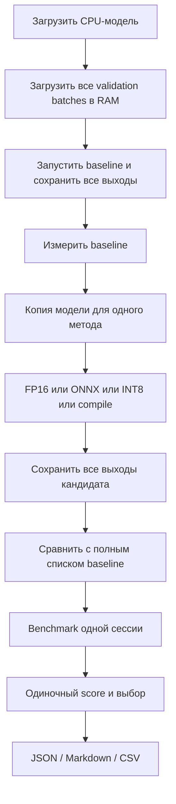
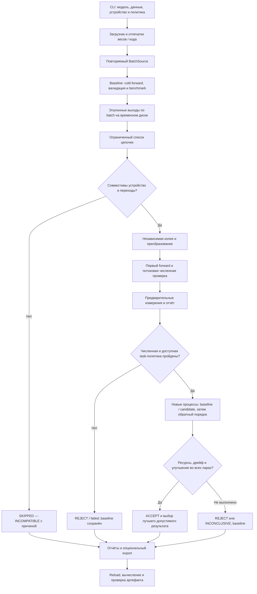
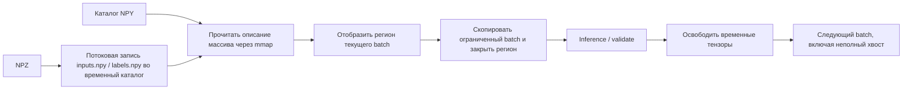
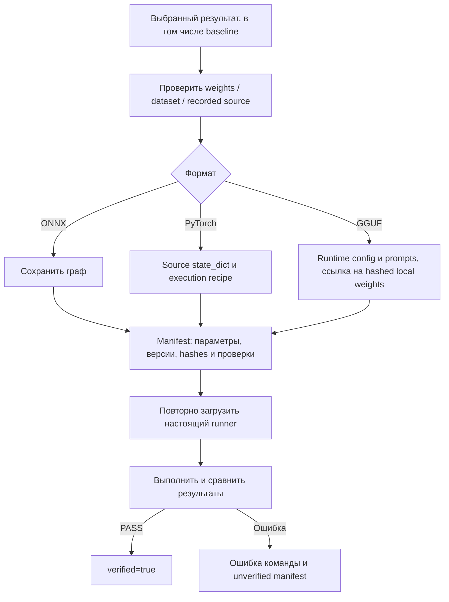

# Kernelixx: что изменилось относительно предыдущей версии

Дата: 8 ноября 2026. База сравнения — опубликованный коммит
[`0325bbf`](https://github.com/lsimg/Kernelixx/commit/0325bbf8b94dfefb528e3b34d9357a1ecf85988d).
Документ описывает реализованные изменения, их пользу, проверку и ограничения.
V2 обозначает архитектуру модернизации; версия Python-пакета остаётся `0.1.0`.

Kernelixx сохранил назначение терминального инструмента для существующих моделей.
PyTorch-модель предоставляется пользователем или загружается из torchvision;
локальные GGUF выполняются отдельным native backend. Веб-сервер, GUI, Ollama и
новые обязательные тяжёлые зависимости не добавлялись.

Главное изменение — переход от одиночного сравнения методов к ограниченному поиску
совместимых цепочек с потоковой обработкой, независимыми повторами и проверяемым
экспортом. ONNX, FP16, динамический INT8 и `torch.compile` существовали раньше.
Ускорение через ONNX не приписывается изобретению нового backend в этой правке.

## 1. Система целиком: было и стало

### Предыдущий путь



Преимущества исходной реализации сохранены: фиксированные seeds, синхронизация
CUDA, численная проверка каждого элемента, реальные размеченные accuracy-метрики
при наличии данных, видимые отрицательные результаты и опциональные backend.
Основные ограничения были в накоплении данных/выходов, узком учёте памяти,
отсутствии композиций и принятии результата по одной сессии.

### Новый путь `optimize-pipeline`



Некоторые предварительные метрики собираются и для отклонённых кандидатов,
чтобы видеть цену преобразования. Эти измерения не дают им права победить.
`analyze` остаётся диагностическим PyTorch Profiler, а не доказательством
автоматического поиска индивидуальных оптимальных GPU-кернелов.

## 2. Какие модули изменены и зачем

| Компонент | Раньше | Теперь | Практическая польза |
|---|---|---|---|
| [core/data.py](../kernelixx/core/data.py), optimizer | NPZ разворачивался в массивы и список копий batch | Повторяемый stream; NPZ спулинг, NPY mmap, копирование/закрытие региона | Уменьшение объёма одновременно удерживаемых данных |
| [core/validator.py](../kernelixx/core/validator.py) | Полные списки выходов; double/error tensors размером с batch | ValidationAccumulator и ограниченные численные блоки | Нет полного списка candidate outputs и полного double scratch для больших batch |
| [core/memory.py](../kernelixx/core/memory.py) | CUDA allocated peak в inference benchmark | RSS, delta, lifetime peak, CUDA allocated/reserved/transient, optional NVML | Видны разные источники памяти и границы измерения |
| [core/benchmark.py](../kernelixx/core/benchmark.py) | Post-warmup median/p95; подсчёт размера через BytesIO | Cold/steady/runtime отдельно, drift diagnostic, отдельный memory pass, файловый подсчёт serialization | Меньше лишнего RAM и честнее интерпретация задержек |
| [core/pipeline.py](../kernelixx/core/pipeline.py) | Только отдельные методы | Явная таблица совместимости и две композиции | Проверка полезных сочетаний без полного перебора |
| [core/optimizer.py](../kernelixx/core/optimizer.py) | Последовательные кандидаты и single-session score | Streaming lifecycle, preflight до deepcopy, bounded search, повторное подтверждение | Отбор связан с корректностью и воспроизводимостью |
| [core/repeat.py](../kernelixx/core/repeat.py) | Пример независимых повторов только для batch-study | Общий worker для baseline/candidate, чередование порядка, hashes, ограничения | Сравнение методов в отдельных процессах |
| [models/loader.py](../kernelixx/models/loader.py) | Архитектура и число параметров | Дополнительно state/code fingerprints, в том числе packed quantized state | Изменённый код не маскируется прежними весами |
| [core/export.py](../kernelixx/core/export.py) | Самостоятельного export-контракта не было | Manifest, checksums, execution recipes, реальный reload и validation | Выбранный результат можно сохранить и проверить |
| optimizations/precision, graph, quantization, fusion | FP16, ORT CPU, Linear INT8, guarded Inductor | Методы сохранены; owned INT8 conversion, FP16 precision через compile, ONNX→INT8 | Совместимость и меньше повторного копирования |
| [llm/gguf.py](../kernelixx/llm/gguf.py) | CPU threads, ChatML/raw, TTFT/decode, token comparison | Metadata template, effective settings, prefill pass, optional logits, task checks, KV/offload parameters | Более содержательное сравнение native-конфигураций |
| [cli.py](../kernelixx/cli.py), reporting | Старые команды, schema-1 JSON/MD/CSV | Новые команды и repeat-report reader; прежние команды сохранены | Обновление остаётся терминальным и доступным прежним сценариям |
| [utils/device.py](../kernelixx/utils/device.py), pyproject | Информация об основном стеке | Версии optional memory/native пакетов; memory/NVML extras | Диагностика зависимости от окружения без обязательной установки GPU-инструментов |

`analyzer.py`, существующие модели и небольшой training experiment не заменялись
новыми формальными подсистемами. В исходные 90 тестов не вносились удаления ради
успешного результата. Добавлено 37 случаев — локальный полный набор содержит 127.

## 3. Управление данными и памятью

### BatchSource и время жизни данных



NPZ — ZIP-контейнер: обещать ему прямой mmap без распаковки было бы неверно.
Извлекаются два известных NPY-члена под фиксированными именами, затем данные
читаются частями. Для готового каталога NPY этот этап не нужен. Синтетический
поток заново создаётся из того же seed при каждом проходе.

В Windows оставленные открытыми отображения всех посещённых страниц увеличивали
working set. Поэтому отдельный прочитанный регион закрывается сразу после
ограниченного копирования. Порядок примеров и последний неполный batch сохранены.

Baseline outputs спулируются по batch во временный каталог. Кандидат сравнивается
с одним соответствующим эталоном за раз. Списки всех больших выходов одновременно
не удерживаются. Обратные Python API `make_batches` и `outputs` оставлены для
существующих примеров; они по-прежнему явно материализуют список.

Цена подхода — дополнительный диск и I/O. Требуется место под распакованный NPZ
и эталонные выходы. TemporaryDirectory, закрытие mmap и finally обеспечивают
обычную уборку при завершении и исключениях. Это не обещание, что произвольная
огромная модель или один огромный batch поместятся в любой объём RAM.

### Численная агрегация

Для каждого блока сравнение производится в float64:

```text
abs(candidate - reference) <= atol + rtol * abs(reference)
MAE = сумма абсолютных ошибок / число элементов
Class agreement = число одинаковых argmax / число примеров
Accuracy drop = (baseline_correct - candidate_correct) / число примеров
```

Максимумы абсолютной/относительной ошибки объединяются максимумом, MAE — суммой
и общим числом элементов. Это сохраняет вес короткого хвостового batch.
Средние отдельных batch не усредняются без учёта размера. Точность требует
размеченных данных; class agreement и совпадение выходов не заменяют accuracy.

### Источники memory-метрик

| Метрика | Что учитывает | Что из неё нельзя заключать |
|---|---|---|
| Sampled process RSS | Наблюдаемая RAM процесса, runtime и mapped pages | Это не точный короткий пик и не только модель |
| RSS delta | Разность RSS на концах фазы | Нулевая delta не означает отсутствие временных allocations |
| OS lifetime peak RSS | High-water mark процесса до момента наблюдения | Он включает предыдущие фазы и startup |
| PyTorch allocated / peak | CUDA allocations PyTorch | Не полный VRAM процесса |
| PyTorch reserved / peak | Память CUDA allocator | Не то же самое, что живые тензоры |
| Transient allocated | Пик allocated минус allocated перед forward | Не общий объём памяти GPU |
| Optional NVML process VRAM | Доступная memory-метрика native процесса по UUID GPU | В WDDM может быть недоступна; sampling пропускает пики |

Отсутствующий источник даёт `null` и пояснение. Legacy поле
`peak_gpu_memory_bytes` сохраняет прежний смысл PyTorch allocated peak.
Память наблюдается отдельным post-warmup forward; RSS sampler не работает внутри
серии latency-замеров. Размер сериализации считается через временный файл,
а не model-sized BytesIO. `empty_cache()` применяется после освобождения ссылок
как уборка границы эксперимента, а не как исправление живых удержанных тензоров.

Подробности: [MEMORY_PROFILING.md](MEMORY_PROFILING.md).

## 4. Совместимость и цепочки преобразований

| Цепочка | Реальная область | Статус реализации и проверки |
|---|---|---|
| FP16 | PyTorch CUDA, параметры/buffers/input | Реальные CUDA-тесты; конкретная модель всё равно может не пройти tolerances |
| INT8 | PyTorch CPU dynamic nn.Linear | Выполнение проверено; convolutions остаются FP32 |
| ONNX | ORT CPU, opset 17, dynamic batch | Реальные export/runtime/reload проверки |
| compile | Inductor с доступным compiler/Triton | Адаптер и preflight сохранены; локальное ускорение не подтверждено |
| FP16→compile | CUDA Inductor после half conversion | Композиция реализована; в текущей среде Triton отсутствует, NOT VERIFIED |
| ONNX→INT8 | ORT CPU dynamic MatMul/Gemm | Проверено реальное выполнение; численная политика может отклонить результат |

Динамический ONNX INT8 использует per-channel weights и reduced range.
Первый тест цепочки выявил слишком большое отклонение; настройки преобразования
исправлены без ослабления тестового допуска. Это не универсальная квантизация CNN
и не замена static calibration.

Проверки выполняются до deepcopy: устройство, допустимые переходы, наличие
Linear и библиотек, prerequisites compiler. Поддержка конкретных операций
окончательно устанавливается экспортом и реальным выполнением. Ошибка compilation
остаётся `failed`, а не успешным fallback под тем же названием.

Перебираются максимум шесть известных цепочек. Есть `--max-candidates`, общий
бюджет времени, ограничение trial count и timeout worker. Бюджет предварительного
in-process преобразования проверяется между кандидатами: он не может прервать
один зависший native export/compile. Повторные процессы ограничены timeout и
остатком бюджета. Это явная граница реализации, а не гарантированный hard timeout
каждой внутренней операции.

## 5. Benchmark и выбор: почему одного speedup теперь мало

Раньше один session score мог выбрать небольшое улучшение. Новая строгая ветка
`optimize-pipeline` использует независимое подтверждение:

```mermaid
sequenceDiagram
    participant P as Parent / planner
    participant R as Reference worker
    participant B as Baseline worker
    participant O as Candidate worker
    P->>R: Создать эталонные выходы
    R-->>P: Hashes и validation
    P->>B: Trial 1: baseline в новом процессе
    B-->>P: Timings, memory, validation
    P->>O: Trial 1: candidate в новом процессе
    O-->>P: Timings, memory, validation
    P->>O: Trial 2: candidate в новом процессе
    O-->>P: Результат
    P->>B: Trial 2: baseline в новом процессе
    B-->>P: Результат
    Note over P,O: Далее порядок чередуется; минимум 3 полные пары для ACCEPT
```

Каждый worker проверяет весь validation stream и совпадение отпечатков весов,
Python sources, первого входа и dataset. Сохраняются raw timings, stdout/stderr,
порядок и результаты законченных прогонов. Дополнительный reference worker
не считается независимой парой.

Cold start — первый forward после создания runner, включая lazy compilation.
Setup — преобразование/создание сессии до первого forward. Steady-state требует
наблюдаемой стабильности post-warmup timings. Полное время эксперимента включает
подготовку, валидацию и уборку; это отдельная величина от forward latency.

Drift diagnostic сравнивает медианы первой и последней трети минимум десяти
измерений. Абсолютный дрейф выше 10% даёт UNSTABLE, мало измерений — INSUFFICIENT.
Тогда `steady_state_latency_ms=null`, а повторный selector получает INCONCLUSIVE.
Это инженерная проверка, а не доказательство статистической стационарности.

| Решение | Условие |
|---|---|
| ACCEPT | Минимум 3 полные пары, numerical/доступная task-политика пройдена, сравнимый workload, стабильные timings, настроенные resource limits соблюдены, в каждой паре выигрыш выше margin |
| REJECT | Провал numerical/task-политики, превышение измеренного ограничения или отсутствие достаточного выигрыша во всех парах |
| INCONCLUSIVE | Мало пар, смешанные результаты, дрейф, timeout или недоступная обязательная memory-метрика |

По умолчанию требуется более 1% уменьшения выбранного score. Для latency это
эквивалентно отношению baseline/candidate выше `1 / 0.99`, а не просто положительному
шумовому отклонению. Если никакой результат не принят, остаётся baseline.

Resource limits проверяются, когда пользователь их задаёт. Для RAM используется
доступный OS lifetime RSS peak в момент observation, иначе sampled inference RSS;
для process VRAM — optional NVML. Это наблюдаемые ограничения, не гарантия
против любого непросемплированного будущего пика. CPU memory/balanced objective
не подменяет недоступный CUDA peak размером весов или RSS.

Прежний `select_best` сохранён как descriptive API. Single-session CLI gain
остаётся предварительным и не заменяет baseline. Доверительные интервалы по
нескольким зависимым forward-вызовам не строятся. Три пары не объявляются тестом
статистической значимости. См. [BENCHMARK_METHODOLOGY.md](BENCHMARK_METHODOLOGY.md).

## 6. GGUF: развитие отдельного native-пути

```mermaid
flowchart LR
    A[Локальный GGUF и SHA-256] --> B[Threads / layers / context / KV settings]
    B --> C[Проверить API и GPU capability]
    C --> D[Новый native worker на конфигурацию]
    D --> E[Template, tokenize, отдельный prefill pass]
    E --> F[Warmup и generation requests]
    F --> G[TTFT / decode / RSS / реальные ответы]
    G --> H[Token / text / optional logits / task checks]
    H --> I[Descriptive report и runtime configuration export]
```



Вместо единственного hardcoded ChatML можно выбрать `--prompt-format auto`:
используется поддерживаемый template из метаданных GGUF. Явные ChatML/raw
сохранены. Учитываются native EOS и end-of-turn markers. Записываются фактически
отрендеренные prompts, чтобы формат не менялся незаметно.

TTFT, prompt evaluation throughput, decode tokens/s и полное время генерации
разделены. TTFT не выдаётся за чистое время обработки prompt. Decode использует
N−1 интервалов между содержательными output tokens. Отдельно сохранены загрузка,
inference RSS, исходный файл и версии native runtime.

Добавлены параметры `n_gpu_layers`, `n_threads`, `n_batch`, `n_ubatch`, `n_ctx`,
K/V cache type и flash attention intent. Проверяются constructor arguments и
capabilities. Requested и effective settings различаются: при requested context
128 локальный runtime сообщил effective 256. Точные байты KV-cache API не
предоставляет, поэтому их значение остаётся `null`.

`--validate-logits` сравнивает последние prompt-token logits по словарю через
доступный native context API. Результаты хранятся на диске и сравниваются блоками.
Это проверенный private accessor закреплённой версии binding, а не обещание
стабильного API всех будущих версий. Короткие `expected_exact` задачи оцениваются
отдельно от совпадения токенов.

В текущей сборке llama.cpp GPU offload недоступен: запрос четырёх слоёв получил
SKIPPED — INCOMPATIBLE. Рабочий PyTorch CUDA не доказывает GPU-версию llama.cpp.
K-cache q8_0 исполнился на CPU, но сравнение с f16 выявило logit error выше допуска
при совпадающих коротких ответах. Такой cache вариант не объявлен эквивалентным.

`optimize-llm` сейчас является реальной командой сравнения runtime settings,
но не реализует независимо подтверждённый LLM winner search. Ограничение —
16 thread/layer-конфигураций. Другие модели, chat templates и cache форматы
требуют собственных проверок. Подробности: [LLM_OPTIMIZATION.md](LLM_OPTIMIZATION.md).

## 7. Экспорт и воспроизводимость



Компиляция хранится как рецепт запуска, не как обещание переносимого compiled
binary. PyTorch state загружается с `weights_only=True`; требуется совместимая
доверенная модель-фабрика. ONNX — самостоятельный граф с runtime-контрактом.
GGUF экспорт не копирует веса и использует первый валидированный runtime config,
а не неподтверждённого «победителя» по случайному latency.

Из SoupLite перенесён инженерный принцип stale-check detection. Regression test
показал: изменение только `forward` при прежних весах раньше проходило export,
поскольку reference тоже создавалась заново из изменённого кода. Теперь новые
отчёты фиксируют Python package Kernelixx и прямые factory/model class source
модули. Export и PyTorch recipe reload отклоняют известное изменение sources.
Независимые workers также сверяют source digest.

Это не полный dependency closure и не доказательство неизменности runtime
monkeypatch/native binaries/внешнего состояния. Старые отчёты не удаляются:
их историческая code provenance явно NOT VERIFIED; новое сохранение всё равно
проверяет реальную загрузку/вычисление. Байтовое изменение source, даже комментария
или line endings, может потребовать нового опыта. Успешный numeric reload и
доказанная свежесть исторического кода — разные поля manifest.

## 8. Какие результаты действительно получены

### Изменение расхода ресурсов framework

Сравнение старой и новой реализации: pretrained ResNet50, одни веса и 200
размеченных изображений, batch 8, один CPU thread, три пары новых процессов,
5 warmup / 30 timed calls. Таблица — медианы наблюдений. CPU и CUDA не смешаны.

| Показатель | Раньше | После модернизации | Вывод |
|---|---:|---:|---|
| CPU experiment sampled peak RAM | 984,254 MiB | 897,316 MiB | −8,83%; это RAM всего процесса |
| CPU median batch latency | 948,374 ms | 962,168 ms | +1,45%; ускорения framework forward нет |
| CPU end-to-end experiment | 60,366 s | 63,350 s | +4,94%; дополнительные проверки и I/O имеют цену |
| RAM процесса в CUDA-сценарии | 1434,172 MiB | 1368,137 MiB | −4,60%; это не снижение VRAM |
| CUDA PyTorch peak allocated | 214,947 MiB | 214,947 MiB | Снижение не установлено |
| CUDA post-warmup median | 36,601 ms | 41,990 ms | Наблюдаемая регрессия; drift не позволяет подтвердить steady-state |
| Accuracy на данном subset | 155/200 | 155/200 | Сохранена; это не общая production accuracy |

Полный VRAM процесса в этой серии не измерен. FP16 ResNet50 отклонён численной
политикой, хотя argmax и 155/200 accuracy совпали. Нет основания ослаблять
tolerances ради положительной строки speedup. Изолированные численные проверки
и размер сериализации сохранены в [PERFORMANCE_RESULTS.md](PERFORMANCE_RESULTS.md).

### Выбор backend в отдельном synthetic-сценарии

Это другой workload: ResNet18 со случайными seeded weights, вход `[1,3,64,64]`,
CPU, три validation batches, без размеченной task-accuracy.

| Сессия | Warmup / timings | Независимые пары | Медиана latency speedup ONNX | Результат |
|---|---|---|---:|---|
| Development stability run | 10 / 30 | 3 | 2,53337× | Все numerical/drift gates PASS, ACCEPT, export reload PASS |
| Последний пользовательский demo | 10 / 30 | 3 | 2,44804× | Все numerical/drift gates PASS, ACCEPT, export reload PASS |

В пользовательском demo первичная таблица показывала 13,0003 → 5,355 ms,
то есть 2,428×. Независимые отношения — 2,35119×, 2,51149×, 2,44804×.
Поэтому подтверждающая медиана — 2,44804×, а не число из первичной таблицы.
Максимальная абсолютная ошибка — 1,25169754e−6. Это подтверждает пригодность
ONNX в данном сценарии, а не универсальное ускорение всех моделей или новую
точность распознавания. Сессии не объединяются в один статистический sample.

[Данные последнего demo](experiments/manual-demo-20261108.json) включают raw
timings, независимые результаты и сведения о проверенном экспорте. Файлы модели,
локальные пути, веса и исходные пользовательские данные не публикуются.

## 9. Как использован GPU-KERNEL.zip

Предоставленный архив содержит SoupLite, а не другую Kernelixx codebase.
Определена основная `souplite-v5-memory`, проверены CRC и согласованность
15 solution-файлов с evidence ZIP, hashes обеих сохранённых T4-серий.
257 symlink entries не извлекались. Запущены девять прочитанных CPU-тестов
chunked loss; два GPU-теста не выбирались.

Тренировочная экономия SoupLite около 40% не переносится на Kernelixx: там
Qwen/LoRA, большой vocabulary head, backward recomputation и другой runtime.
Сохранённый solution peak 8603 MiB уже превышает память этой 8 GB GPU.
Ни эти kernels, ни веб-приложение, ни contest-specific запреты не стали
автоматически частью Kernelixx. Полный [аудит референса](SOUPLITE_REFERENCE_AUDIT.md).

## 10. Совместимость и воспроизведение

Старые команды `analyze`, `benchmark`, `optimize`, `auto-optimize`, `compare`,
`system-info`, `train-benchmark`, `gguf-benchmark` сохранены. Добавлены
`profile-memory`, `optimize-pipeline`, `benchmark-repeat`, `optimize-llm`, `export`.
У каждой есть help, аргументы и проверка ошибок. Schema-1 отчёты читаются;
добавлены новые поля и тип benchmark-repeat. JSON содержит полную вложенную
структуру метрик; CSV хранит её скалярное представление.

PowerShell из исходной папки с уже настроенной `.venv`:

```powershell
.\.venv\Scripts\python.exe -m kernelixx system-info
.\.venv\Scripts\python.exe -m kernelixx optimize-pipeline `
  --model resnet18 --weights none --device cpu --input-shape 1,3,64,64 `
  --pipelines onnx --max-candidates 1 --trials 3 --warmup 10 --repeats 30 `
  --output results/demo
.\.venv\Scripts\python.exe -m kernelixx compare --run-dir results/demo/latest
.\.venv\Scripts\python.exe -m kernelixx export `
  --run-dir results/demo/latest --output results/demo-export-NEW
.\.venv\Scripts\python.exe -m pytest -q --basetemp=results/pytest-NEW
```

Для native GGUF integration задаётся `KERNELIXX_TEST_GGUF_MODEL` на локальный
GGUF-файл. Без него этот тест явно пропускается. CPU CI также пропускает
недоступные CUDA cases — это не GPU PASS. Pytest владеет своим basetemp:
туда нельзя помещать важные пользовательские файлы.

Ненулевой код возвращается при ошибке аргументов/выполнения; одиночная
несовместимая `optimize` тоже сигнализирует кодом 2. Завершённый поиск может
оставить baseline с exit 0: для решения нужно читать `selection`, а не только
факт завершения команды. Export требует нового каталога, чтобы не перезаписать
существующий артефакт.

## 11. Проверки и оставшиеся границы

* Полный локальный набор: 127 passed, включая реальные CUDA, ORT и local GGUF.
  Прежние 90 тестов сохранены. Последний предоставленный пользовательский вывод
  также содержит 127 passed, 14 upstream warnings, 37,50 s.
* Отдельные девять CPU cases SoupLite не считаются дополнительными Kernelixx GPU
  тестами. Полное T4 обучение не запускалось.
* Wheel/sdist/source ZIP проверены на состав и соответствие source bytes.
  Target-installed wheel использует существующее dependency environment;
  это не независимая чистая установка всех зависимостей.
* `.github/workflows/tests.yml` сохраняет Windows/Linux и Python 3.11/3.12 CPU
  matrix. Результат GitHub Actions нужно смотреть у соответствующего commit;
  локальные проверки его не доказывают.
* Не заявлены: GPU ORT, подтверждённое ускорение Inductor, собственные Triton
  kernels, generic detection/transformer adapters, training checkpointing,
  точные KV-cache bytes и статистически подтверждённый LLM winner search.

Польза обновления — измеримый меньший RAM в проверенном сценарии, ограниченный
поиск совместимых методов, более надёжное решение ACCEPT/REJECT/INCONCLUSIVE
и сохранение результата с проверяемой историей. Преобразование, которое успешно
запустилось, по-прежнему обязано доказать пользу на конкретной задаче.
